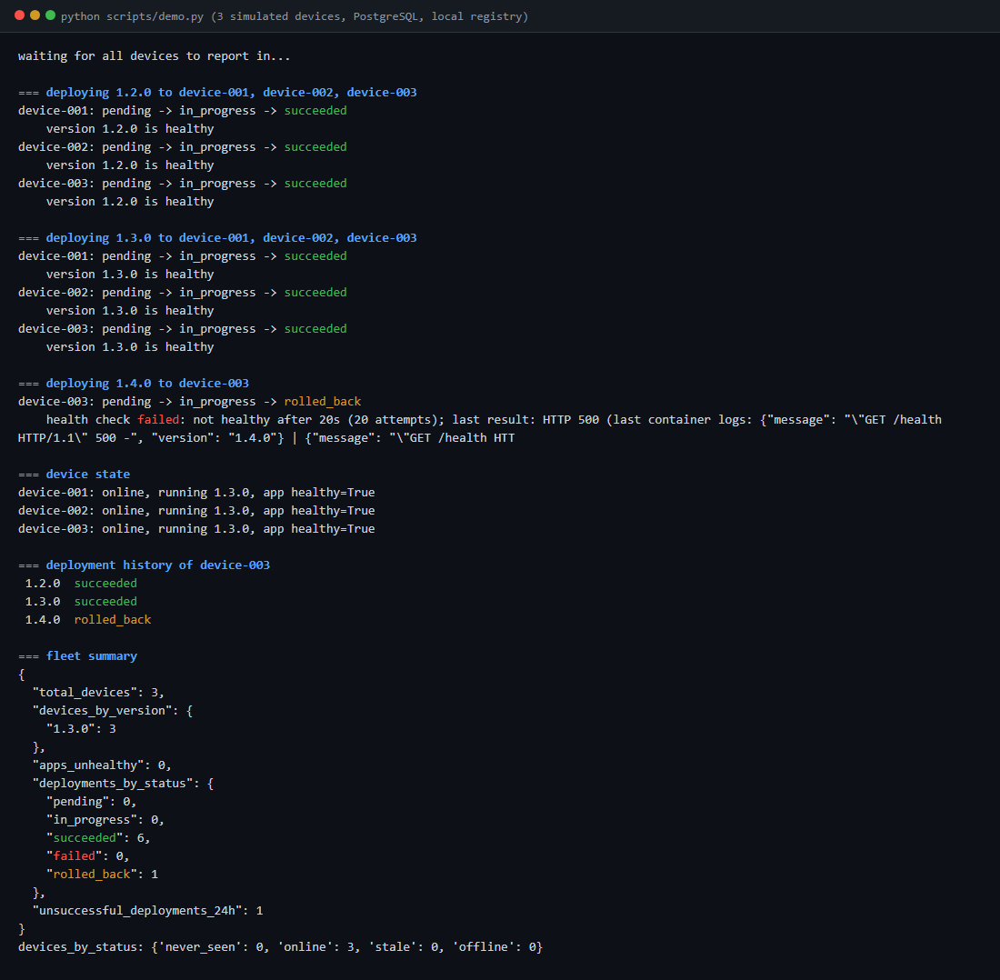
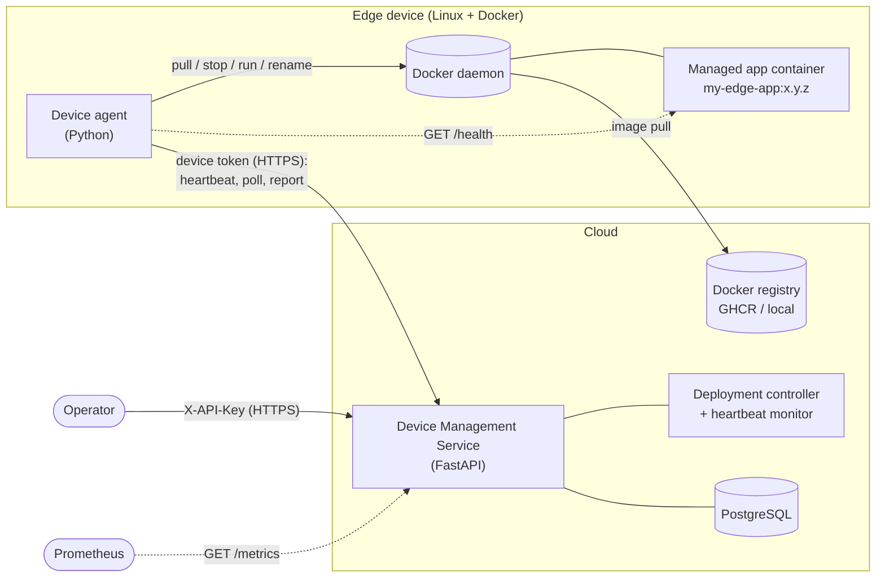
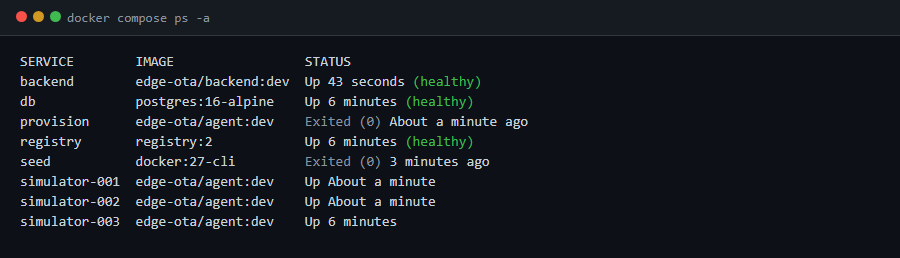
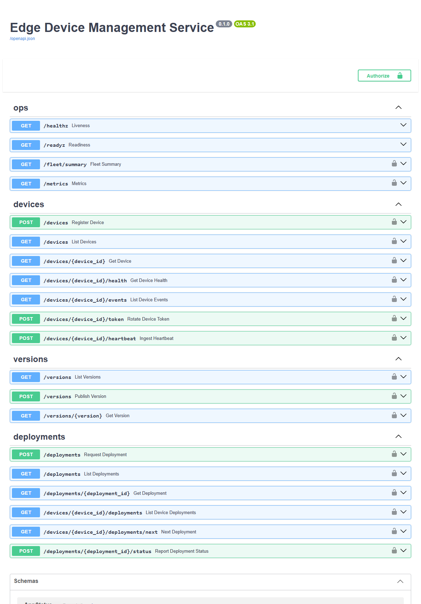
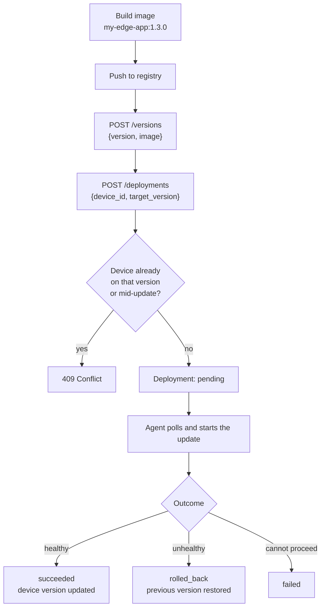
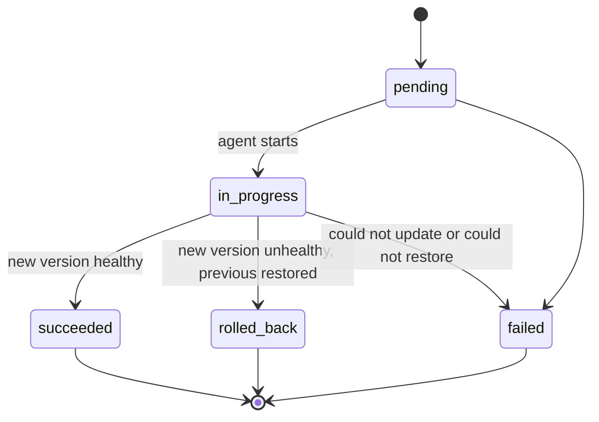
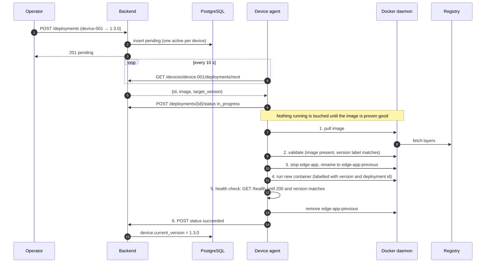
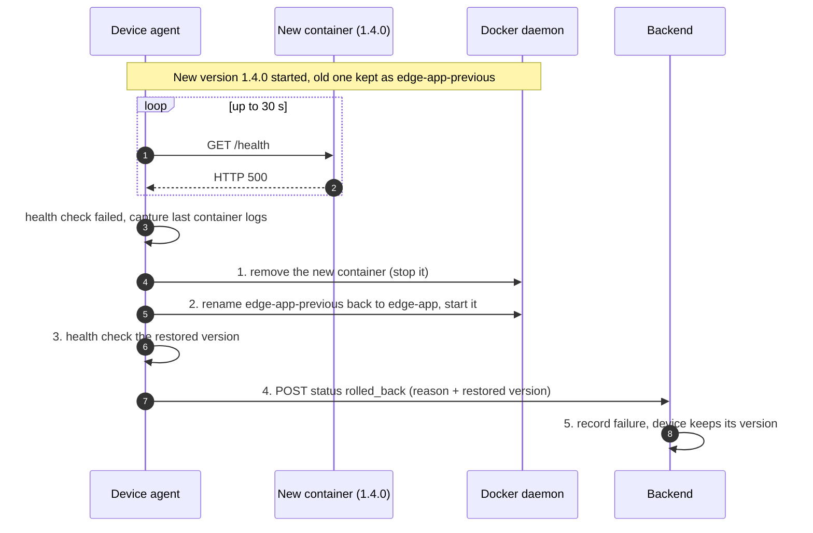
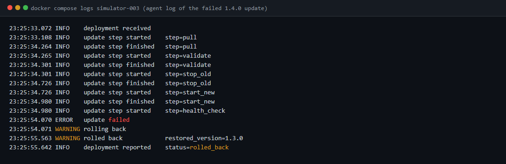

# Edge Device Management and OTA Platform

A cloud platform that monitors a fleet of Linux edge devices and rolls out
software updates to them over the air, packaged as Docker images, with
**automatic rollback** when a new version fails its health check.

It is a complete, runnable system: a device agent, a device-management API on
PostgreSQL, a deployment controller with an enforced state machine, per-device
authentication, monitoring, a containerised local environment with simulated
devices, and a CI/CD pipeline that publishes images to GitHub Container Registry.



## Contents

1. [Problem statement](#problem-statement)
2. [Architecture](#architecture)
3. [Quick start](#quick-start)
4. [Deployment workflow](#deployment-workflow)
5. [OTA update sequence](#ota-update-sequence)
6. [Rollback sequence](#rollback-sequence)
7. [API documentation](#api-documentation)
8. [Configuration](#configuration)
9. [Security considerations](#security-considerations)
10. [Monitoring and observability](#monitoring-and-observability)
11. [Testing](#testing)
12. [CI/CD](#cicd)
13. [Design decisions and trade-offs](#design-decisions-and-trade-offs)
14. [Failure modes](#failure-modes)
15. [Limitations and future improvements](#limitations-and-future-improvements)
16. [Repository layout](#repository-layout)

## Problem statement

You have many Linux devices in the field, each running a containerised
application. You need to:

- **see** which devices are alive, what version they run, and whether their
  application is healthy;
- **ship** a new version to a device remotely, without SSH access;
- **never brick** a device: a bad release must not leave it without a working
  application, even if the network drops halfway through;
- **know what happened**: which version went where, when, and why a rollout failed.

Devices sit behind NAT, on flaky links, and outnumber the people operating them,
so the design is *pull-based* and *self-healing*: devices initiate every
connection, and the device decides locally whether an update worked.

## Architecture



The original sketch was *agent → MQTT/API → service → database → deployment
controller → registry*. This implementation uses **HTTPS polling** rather than
MQTT: the agent only makes outbound requests, every command is tied to an
auditable deployment record, and there is no broker to operate. The transport is
behind a small interface (`HeartbeatSink`), so MQTT could be added later.

| Component | Responsibility | Where |
|---|---|---|
| **Device agent** | Collect metrics, send heartbeats, poll for deployments, apply updates, roll back locally, report outcomes | [agent/](agent) |
| **Device registry** | Register devices, issue/rotate tokens, derive liveness from heartbeats | [backend/src/device_mgmt/services/registry.py](backend/src/device_mgmt/services/registry.py) |
| **Version catalog** | Map a semantic version to the Docker image that ships it | [services/versions.py](backend/src/device_mgmt/services/versions.py) |
| **Deployment controller** | Record desired state, enforce the state machine, keep history | [services/deployments.py](backend/src/device_mgmt/services/deployments.py) |
| **Heartbeat monitor** | Detect devices going quiet, record events, prune old heartbeats | [services/monitor.py](backend/src/device_mgmt/services/monitor.py) |
| **PostgreSQL** | Devices, versions, deployments, events, heartbeat history | SQLAlchemy models |
| **Docker registry** | Stores the application images (GHCR in CI, `registry:2` locally) | compose / CI |
| **edge-app** | The workload being updated; exposes `/health`; version 1.4.0 is deliberately broken | [edge-app/](edge-app) |

### Principles

- **The backend records intent; the device performs it.** The backend never
  connects to a device. It stores a pending deployment and the agent reconciles.
- **The device is authoritative about itself.** The running container's label,
  not a state file, says what version it runs; the health check, not the
  backend, decides whether an update worked.
- **Clean layering.** `api` (HTTP) → `services` (rules) → `db` (persistence).
  Services import no web framework; Docker sits behind a `ContainerRuntime`
  interface so the update logic is tested without a daemon.

## Quick start

Requirements: Docker with Compose v2, Python 3.11+.

```bash
cp .env.example .env
# Edit .env: set POSTGRES_PASSWORD and DEVICE_MGMT_ADMIN_API_KEY to random values, e.g.
#   python -c "import secrets; print(secrets.token_urlsafe(32))"

docker compose up -d --build --wait     # backend, PostgreSQL, registry, 3 simulated devices
python scripts/demo.py                  # upgrade, upgrade, broken release, rollback
```

`docker compose up` runs two one-shot services before the devices start:
`seed` builds the test app at versions 1.1.0 to 1.4.0 and pushes them to the
local registry, and `provision` publishes those versions, registers the three
devices and gives each its own token in its own volume.



Each simulated device is a **real agent container managing a real application
container** (`edge-app-device-NNN`) through your Docker daemon. Nothing is mocked.

Useful commands:

```bash
make logs                      # follow backend and agent logs
make check                     # lint + type check + all tests (after `make install`)
make clean                     # remove containers, volumes and app containers
docker compose --profile tls up -d caddy   # optional HTTPS front end on :8443
```

Interactive API docs: <http://localhost:8000/docs>. On Linux, set `DOCKER_GID`
in `.env` (`getent group docker | cut -d: -f3`) so agents can use the Docker
socket without running as root.



### Running the agent on a real Linux device

```bash
pip install ./agent
export EDGE_AGENT_DEVICE_ID=device-001
export EDGE_AGENT_BACKEND_URL=https://fleet.example.com
export EDGE_AGENT_DEVICE_TOKEN_FILE=/etc/edge-agent/token   # issued by POST /devices
edge-agent                    # or: edge-agent --dry-run --once  to print one heartbeat
```

A systemd unit is the usual way to run it. The following is an illustrative
sketch and was **not** exercised by this repository's tests:

```ini
[Service]
User=edge-agent
SupplementaryGroups=docker
EnvironmentFile=/etc/edge-agent/agent.env
ExecStart=/usr/local/bin/edge-agent
Restart=always
NoNewPrivileges=yes
ProtectSystem=strict
ProtectHome=yes
PrivateTmp=yes
```

## Deployment workflow



A deployment moves through an enforced state machine. Any other transition is
rejected with `409`, and terminal states are final.



| Status | Meaning |
|---|---|
| `pending` | Requested; the device has not picked it up yet |
| `in_progress` | The agent is updating |
| `succeeded` | New version running and healthy; the device's version is updated |
| `rolled_back` | The update failed and the **previous version was restored and verified healthy** |
| `failed` | The update did not complete and no rollback restored the old version: it failed before anything was switched (bad image, pull error, in which case nothing changed on the device), or the rollback itself failed |

Every transition is stored as an event, so `GET /deployments/{id}` is a full
audit trail, and `GET /deployments?status=failed` is the failed-deployment view.

## OTA update sequence



Key properties:

- **Zero downtime for bad images.** Pull and validation happen *before* the old
  container is stopped, so a missing image or mis-tagged release changes nothing.
- **The old container is kept, not deleted**, until the new one is healthy.
- **Health means the right version.** The check requires HTTP 200 *and* that the
  app reports the version just deployed, so a leftover old container on the same
  port cannot pass for the new one.
- **Reporting is reliable.** The agent tells the backend `in_progress` *before*
  changing anything, and holds the final result and retries it until delivered,
  without repeating the update.
- **Restart-safe.** If the agent restarts mid-update it finds the deployment
  still `in_progress`, notices the new container already carries that
  deployment's ID, and only re-verifies and reports.

## Rollback sequence

Rollback is performed by the **agent, locally**. It needs no backend and no
registry: the previous version is a stopped container that already ran
successfully on this device.



The failure is recorded in the backend with its reason, including the failing
container's last log lines:



If the restored version is itself unhealthy, or restoring fails, the result is
reported as `failed` (not `rolled_back`) so the operator knows the device needs
attention. Failures that happen *before* the old version was touched are
reported as `failed` with "nothing was changed on the device".

## API documentation

Interactive docs are served at `/docs` and the schema at `/openapi.json`.
Two credentials exist and are **not interchangeable**:

- `X-API-Key: <admin key>` for operators
- `Authorization: Bearer <device token>` for a device agent, valid only for that device

### Operator endpoints (`X-API-Key`)

| Method | Path | Purpose |
|---|---|---|
| `POST` | `/devices` | Register a device. The response contains its `device_token`, **shown once** |
| `GET` | `/devices` | List devices (`limit`, `offset`); each includes its liveness `status` |
| `GET` | `/devices/{device_id}` | One device |
| `GET` | `/devices/{device_id}/health` | Liveness, seconds since last heartbeat, latest metrics, application health |
| `GET` | `/devices/{device_id}/events` | Status and application-health changes, newest first |
| `POST` | `/devices/{device_id}/token` | Rotate the token; the old one stops working immediately |
| `POST` | `/versions` | Publish a version: `{"version": "1.3.0", "image": "registry/my-edge-app:1.3.0"}` |
| `GET` | `/versions`, `/versions/{version}` | Available versions, in semver order |
| `POST` | `/deployments` | Request a deployment: `{"device_id": "device-001", "target_version": "1.3.0"}` |
| `GET` | `/deployments` | History; filter by `device_id` and `status` |
| `GET` | `/deployments/{id}` | One deployment with its event history |
| `GET` | `/devices/{device_id}/deployments` | A device's deployment history |
| `GET` | `/fleet/summary` | Devices by status and version, deployments by status, recent failures |
| `GET` | `/metrics` | Prometheus text format |

### Device endpoints (device token)

| Method | Path | Purpose |
|---|---|---|
| `POST` | `/devices/{device_id}/heartbeat` | Report metrics (`202`) |
| `GET` | `/devices/{device_id}/deployments/next` | The deployment to work on, or `204` |
| `POST` | `/deployments/{id}/status` | Report `in_progress`, `succeeded`, `failed` or `rolled_back` |

### Open endpoints

`GET /healthz` (process is up) and `GET /readyz` (database reachable). `/docs`
and `/openapi.json` are open; disable them in production if the schema is sensitive.

### Examples

```bash
KEY=$(grep ^DEVICE_MGMT_ADMIN_API_KEY .env | cut -d= -f2)

# Register a device (note the one-time token in the response)
curl -s -X POST localhost:8000/devices -H "X-API-Key: $KEY" \
     -H "Content-Type: application/json" -d '{"device_id": "device-010"}'

# Request an update
curl -s -X POST localhost:8000/deployments -H "X-API-Key: $KEY" \
     -H "Content-Type: application/json" \
     -d '{"device_id": "device-001", "target_version": "1.3.0"}'

# Device health
curl -s localhost:8000/devices/device-001/health -H "X-API-Key: $KEY"
```

### Heartbeat message

```json
{
  "schema_version": 1,
  "device_id": "device-001",
  "hostname": "device-001",
  "software_version": "1.3.0",
  "cpu_percent": 9.2,
  "memory_percent": 41.0,
  "disk_percent": 23.6,
  "uptime_seconds": 93449.3,
  "network": {"interfaces_up": ["eth0"], "ip_address": "172.20.0.5", "backend_reachable": true},
  "app": {"state": "running", "healthy": true, "version": "1.3.0"},
  "timestamp": "2026-11-11T23:25:03.959016Z"
}
```

`app.state` is one of `running`, `stopped`, `absent`, `updating`, `unknown`. While
an update is in flight the state is `updating` and health is deliberately not
judged, so a normal update never raises a false alarm.

### Errors

| Code | Meaning |
|---|---|
| `400` | Heartbeat body's `device_id` does not match the URL; HTTPS required |
| `401` | Missing or invalid credentials (identical for "no such device" and "wrong token") |
| `403` | Valid device token, but for a different device |
| `404` | Unknown device, version or deployment (a deployment belonging to another device also returns `404`) |
| `409` | Duplicate, device already on that version, device has an active deployment, or invalid state transition |
| `422` | Validation error (for example a version that is not `MAJOR.MINOR.PATCH`) |

## Configuration

All configuration comes from environment variables; there are no credentials in
code or images. Copy [.env.example](.env.example) to `.env` (gitignored).

### Backend (`DEVICE_MGMT_*`)

| Variable | Default | Purpose |
|---|---|---|
| `ADMIN_API_KEY` | **required** | Operator key, at least 16 characters. The service refuses to start without it |
| `DATABASE_URL` | `sqlite:///./device_mgmt.db` | SQLAlchemy URL; PostgreSQL in compose |
| `REQUIRE_HTTPS` | `false` | Reject plain HTTP and send HSTS (behind a TLS proxy) |
| `HEARTBEAT_STALE_AFTER_SECONDS` | `90` | Silence before a device is `stale` |
| `HEARTBEAT_OFFLINE_AFTER_SECONDS` | `300` | Silence before a device is `offline` |
| `MONITOR_INTERVAL_SECONDS` | `15` | Monitor period (`0` disables the background monitor) |
| `HEARTBEAT_RETENTION_DAYS` | `7` | Raw heartbeat rows older than this are deleted |
| `LOG_LEVEL` | `INFO` | |

### Agent (`EDGE_AGENT_*`)

| Variable | Default | Purpose |
|---|---|---|
| `DEVICE_ID` | hostname | Must match the registered device |
| `BACKEND_URL` | required unless dry run | `https://...` in production |
| `DEVICE_TOKEN` / `DEVICE_TOKEN_FILE` | one required | The token, or a file containing it (preferred) |
| `CA_BUNDLE` | system roots | PEM bundle for a private CA. Verification cannot be disabled |
| `HEARTBEAT_INTERVAL_SECONDS` | `30` | |
| `UPDATES_ENABLED` | `true` | Set `false` for a monitoring-only agent |
| `DEPLOYMENT_POLL_INTERVAL_SECONDS` | `10` | |
| `APP_CONTAINER_NAME` / `APP_CONTAINER_PORT` | `edge-app` / `8080` | The managed container |
| `APP_HOST_PORT` / `APP_NETWORK` | unset | Publish a host port, or attach to a Docker network instead |
| `APP_HEALTH_URL` | derived | Where the health check goes |
| `APP_HEALTH_TIMEOUT_SECONDS` | `30` | How long a new version has to become healthy |
| `IMAGE_PULL_POLICY` | `always` | or `if_not_present` |
| `DRY_RUN` | `false` | Print heartbeats instead of sending them |

## Security considerations

| Concern | Measure |
|---|---|
| **Operator authentication** | `X-API-Key`, compared in constant time on digests. Required at startup, minimum length enforced, never logged or echoed |
| **Device authentication** | Each device has its own random 256-bit token, shown once. Only its SHA-256 hash is stored, so a database leak yields no usable tokens |
| **Least privilege (API)** | A device token can only heartbeat, fetch its own next deployment, and report on its own deployments. It cannot read the fleet, request deployments or touch other devices. The operator key is rejected on device endpoints |
| **No enumeration** | Unknown device and wrong token give the same `401`; another device's deployment ID gives `404` |
| **Token lifecycle** | `POST /devices/{id}/token` rotates immediately; compromise of one device does not affect the others |
| **Secrets** | Environment only (`.env` is gitignored, compose refuses to start without them). Agents read their token from a **file in a per-device volume**, so it is not in the environment or in `docker inspect`, and each device can see only its own |
| **Transport** | HTTPS-ready: `DEVICE_MGMT_REQUIRE_HTTPS` rejects plain HTTP and sends HSTS, honouring `X-Forwarded-Proto` from a trusted proxy; the Caddy profile demonstrates TLS 1.3 termination. The agent always verifies certificates, supports a private CA, and warns if configured with plain HTTP |
| **Response hygiene** | `Cache-Control: no-store` (responses can carry tokens), `X-Content-Type-Options: nosniff`; request logs record method, path, status and timing only, never headers or bodies, and a test asserts credentials never appear in logs |
| **Input validation** | Strict Pydantic models (`extra="forbid"`), semver-only versions, device IDs limited to `[A-Za-z0-9._-]` (they appear in URLs), image references restricted to a safe character set |
| **Container hardening** | Backend and agent run as non-root with all capabilities dropped, `no-new-privileges`, read-only root filesystems. The test app is non-root. `provision` is the one service with extra capabilities (`CHOWN`, `DAC_OVERRIDE`) and runs only briefly |
| **Supply chain** | CI scans images with Trivy before publishing, attaches provenance and an SBOM, and Dependabot tracks dependencies |

**Honest limitations**

- **The agent needs the Docker socket, which is root-equivalent on the host.** A
  compromised agent can control every container on the device. In production,
  place a filtering socket proxy in front of it, or use rootless Docker.
- **Image authenticity is not verified.** Anyone who can push to the registry can
  ship code to devices. Image signing and agent-side verification (cosign) are the
  fix and are listed under future work.
- No rate limiting or lockout on the operator key; use a strong key and network controls.
- The operator key is a single shared secret. Per-operator identities, roles and
  audit attribution would replace it in a real deployment.
- Agents read their token at startup, so after a rotation the agent must be
  restarted. A lockout from a rotated token shows up as heartbeats failing with `401`.

## Monitoring and observability

- **Structured logs.** Backend and agent emit one JSON object per line on stderr.
  Every request is logged with a request ID (echoed in `X-Request-ID`), and every
  update step is logged with its deployment ID, so a rollout can be traced across
  the device and the cloud.
- **Heartbeat monitoring.** Status is derived from the server's receive time (not
  the device's clock, which may be wrong): `online`, `stale` after 90 s, `offline`
  after 300 s, `never_seen` before the first heartbeat. A background monitor logs
  a `WARNING` and records a device event at the moment a device goes quiet;
  recovery is recorded by the heartbeat itself.
- **Application health.** The agent probes the managed app on every heartbeat.
  `GET /devices/{id}/health` reports `healthy` only if the device is online *and*
  its application is not known to be failing; `app_unhealthy` and `app_recovered`
  events are recorded once per change.
- **Deployment history.** Every deployment keeps an append-only event log; the
  failed and rolled-back ones are queryable and counted in `/fleet/summary`.
- **Metrics.** `/metrics` exposes fleet gauges (devices by status and version,
  unhealthy apps, deployments by status, failures in the last 24 h) and an HTTP
  request counter labelled by route *template* to keep cardinality bounded.
- **Probes.** `/healthz` for liveness and `/readyz` (checks the database) for
  readiness; compose uses `/readyz`.
- **Retention.** Raw heartbeats are pruned after seven days; device state,
  events and deployment history are kept.

Prometheus scrape example (needs Prometheus 2.55+ for `http_headers`):

```yaml
scrape_configs:
  - job_name: device-mgmt
    metrics_path: /metrics
    http_headers:
      X-API-Key:
        values: ["<admin key>"]
    static_configs: [{targets: ["backend:8000"]}]
```

Example alert: `device_mgmt_devices{status="offline"} > 0`, or
`device_mgmt_unsuccessful_deployments_24h > 0`.

## Testing

```bash
make install && make check        # or run pytest in agent/ and backend/
```

| Suite | Tests | What it covers |
|---|---|---|
| Agent | 89 | Config validation, metrics collection, heartbeat loop resilience, every OTA step and its failure, rollback in all its branches (including interrupted updates and a failed rollback), report retry semantics, health checking, app status |
| Backend | 117 | API contract, state machine (valid and invalid transitions), database-enforced one-active-deployment rule, authentication and cross-device isolation, token rotation, HTTPS policy, monitor transitions, retention, metrics, log hygiene |
| End to end | 1 | `scripts/demo.py` on the compose stack: real PostgreSQL, registry, agents and containers, asserting two successful upgrades and a rollback |

Ruff (lint and format) and strict mypy run over both packages.

Design choices that make this testable: the Docker runtime, HTTP clients and
clocks are injected, so rollback logic is exercised deterministically with a
fake runtime, and a separate end-to-end run proves the real Docker path.

**What the tests do not cover:** the unit suites run on SQLite (PostgreSQL is
exercised by the end-to-end run); the end-to-end run used Docker Desktop on
Windows with Linux containers, not bare-metal Linux or ARM hardware; and there
is no load or chaos testing.

## CI/CD

[.github/workflows/ci.yml](.github/workflows/ci.yml) runs on every push, pull
request and `v*` tag:

1. **test**: ruff, format check, mypy and pytest for the agent and backend on Python 3.11 and 3.12.
2. **compose**: validates `docker-compose.yml` (including the TLS profile), lints scripts, runs shellcheck.
3. **e2e**: starts the real stack on the runner and runs the OTA scenario, failing the build if an upgrade does not succeed or the broken release is not rolled back.
4. **images**: builds the backend, agent and test-app images, scans each with Trivy (fails on fixable critical vulnerabilities), then publishes to `ghcr.io/<owner>/<repo>/<name>`.

Image tags: short commit SHA always, the branch name, `1.2.3` and `1.2` on a
version tag, and `latest` only from the default branch. Pull requests build and
scan but never push. The agent and test-app images are multi-arch
(`linux/amd64`, `linux/arm64`) because edge hardware is frequently ARM. Provenance
and SBOM attestations are attached, and the workflow requests only the
permissions each job needs.

The workflow was validated locally with `actionlint`, and the end-to-end job's
steps were run by hand against the same compose stack, but it has **not yet run
on GitHub**: that happens on the first push.

## Design decisions and trade-offs

| Decision | Why | Trade-off |
|---|---|---|
| **Polling over MQTT push** | Outbound-only connections work behind NAT; each command is a durable, auditable record; no broker | Update latency of up to one poll interval; MQTT would suit large fleets needing instant commands |
| **Rollback on the device** | Works when the network is down mid-update; the previous container already ran here | The agent needs enough disk for two versions |
| **Keep the old container instead of re-pulling** | Rollback is instant and offline | Slightly higher disk use during an update |
| **Container labels as the source of truth for the running version** | No state file that can drift from reality | Containers started outside the agent have no version |
| **Hash-only token storage** | Tokens are 256-bit random, so a fast hash is sufficient and a DB leak is harmless | Lost tokens cannot be recovered, only rotated |
| **Server receive time for liveness** | Edge devices often have wrong clocks | Does not detect a device whose clock is wrong (the device timestamp is stored separately) |
| **Computed status plus a monitor** | Reads are always correct; the monitor adds detection and events | One more component; a multi-replica deployment would need leader election for the monitor |
| **Partial unique index for one active deployment per device** | The database guarantees it under concurrency, not just application code | Needs PostgreSQL or SQLite 3.8+ |
| **Health check requires the expected version** | Prevents an old container on the same port passing for the new one | The app must report its version |
| **`updating` state during OTA** | A new container is expected to be unready briefly, which is not an incident | Health is not monitored during the update window |
| **Docker SDK behind an interface** | Update and rollback logic is unit-tested without Docker | A thin real implementation needs the end-to-end run to verify |
| **No Alembic migrations (yet)** | Keeps the demo simple; tables are created at startup | Schema changes need migrations before real use |

## Failure modes

| What goes wrong | What happens |
|---|---|
| Image does not exist or cannot be pulled | `failed`, "nothing was changed on the device"; old version never stopped |
| Image's version label disagrees with the request | Rejected at validation, before any downtime |
| New version starts but fails its health check | Rolled back locally; reported `rolled_back` with the container's last log lines |
| Rollback itself fails or the old version is unhealthy | Reported `failed`; the operator is told the device needs attention |
| Backend unreachable when the update finishes | Agent keeps the result and retries until delivered, without repeating the update |
| Backend unreachable at the start | The agent has changed nothing, and retries the poll |
| Agent crashes or restarts mid-update | On restart it finds the in-progress deployment, verifies, and reports, or rolls back |
| Docker daemon down | Heartbeats keep flowing with application state `unknown`; updates fail cleanly |
| Device stops sending heartbeats | `stale` then `offline`, logged as a warning and recorded as an event |
| Two operators request an update for one device | One succeeds, the other gets `409` (enforced by the database) |
| Duplicate status reports from a retry | Idempotent; no duplicate history |
| A device token is leaked | Rotate it; it only ever granted access to that one device |

## Limitations and future improvements

- **Staged rollouts.** Deploy to device groups, canary a percentage, pause on
  failure rate, and roll out automatically in waves.
- **Image signing and verification** (cosign) enforced by the agent, plus
  digest pinning instead of mutable tags.
- **MQTT or long-polling** for near-instant commands, with the current polling
  retained as a fallback.
- **Agent token reload** on `401` without a restart, and automatic token rotation.
- **Alembic migrations** and a dedicated migration job.
- **Per-operator identities, roles and audit logs** (OIDC) instead of one API key.
- **Docker socket proxy** or rootless Docker; seccomp/AppArmor profiles for the agent.
- **Delta updates** and download resume for slow links; bandwidth limits.
- **Multi-container applications** (Compose or Kubernetes/k3s workloads) rather than one container.
- **Monitor leader election** for multi-replica backends, and a dashboard UI.
- **Observability:** OpenTelemetry traces across device and cloud, Grafana dashboards and alert rules as code.
- **Infrastructure as code** (Terraform) for the cloud deployment, with the database on a managed service.

## Repository layout

```
.
├── agent/                  Device agent (Python package edge_agent)
│   └── src/edge_agent/     config, collector, service (heartbeat), backend_client,
│                           runtime (Docker), health, updater (OTA + rollback), worker
├── backend/                Device management service (Python package device_mgmt)
│   └── src/device_mgmt/    api/ (routes, auth), services/ (rules), db/ (models), security
├── edge-app/               The managed test application (versions 1.1.0 to 1.4.0)
├── scripts/                demo.py, provision_devices.py, build-edge-app.sh
├── deploy/caddy/           TLS reverse proxy configuration
├── docs/img/               Screenshots used in this README
├── docker-compose.yml      Local stack: backend, PostgreSQL, registry, 3 simulated devices
├── .github/workflows/      CI/CD
├── .env.example            Configuration template
└── Makefile
```
